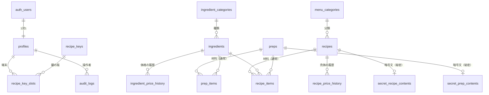

# データベース設計

Supabase（PostgreSQL）に作るテーブル・列・権限・自動処理の設計。

- SQL：`supabase/migrations/`（古い順に実行する）
- テスト：`npm run test:db`（`supabase/tests/run-rls-tests.mjs`。PGlite にマイグレーションを流し、立場を変えて確かめる）
- 作業するブランチ：`feature/supabase`（D-064）

今の画面はまだブラウザの localStorage に保存している（D-008）。ログイン機能を作るときに、`src/lib/store.ts` をこの設計の Supabase に差し替える（D-011）。

## 1. 方針

- **権限はデータベースで守る。** 全テーブルで RLS（行レベルセキュリティ）を有効にし、画面を書き換えても権限を超えた操作はできないようにする（要件定義書 2章・4.2）。
- **二段階認証もデータベースで強制する。** 全ての RLS は `private.is_member()` を通し、停止されていない人だけを通す。**管理者は二段階認証（`aal2`）が必須**、社員は任意（D-082）。
- **秘密の中身はデータベースに平文で置かない。** メニュー・創作レシピ・仕込み品（塩だれなど）の材料構成とメモは画面で暗号化し、暗号文だけを保存する（要件定義書 4.3、D-060・D-066）。
- **誰がいつ変えたかは、データベースが自動で埋める。** 作成者・更新者・日時・価格履歴・操作ログはトリガーで書き、画面から送られた値は使わない。
- **原価は保存しない。** 通常のレシピ・仕込み品の原価は、材料の価格から画面で毎回計算する（`src/lib/cost.ts`）。材料の値上げがすぐ反映され、保存した原価と食い違うことがない。例外は秘密のもので、データベースからは中身が見えないため、管理者の画面で計算した金額を `secret_cost` に保存する。
- **お金は整数の円、量は小数第3位まで**（`numeric(12,3)`）。画面の計算（D-009）と同じ精度。
- **1店舗分として作る。** 店舗は2つあるが、どちらもオーナーのお店で、このアプリは価格を決めるためのものなので、店舗ごとに分けない（D-065）。

## 2. テーブルの関係



## 3. テーブル一覧

| # | テーブル | 内容 | 行数の見込み |
| --- | --- | --- | --- |
| 1 | `profiles` | 利用者（管理者・社員）。`auth.users` と1対1 | 3 |
| 2 | `ingredient_categories` | 材料の種類（肉・野菜…）。D-025・D-053 | 6 |
| 3 | `menu_categories` | メニューの分類。お店のハンディのボタンに合わせる。D-045・D-052 | 21 |
| 4 | `ingredients` | 材料 | 〜300 |
| 5 | `ingredient_price_history` | 価格の履歴。トリガーだけが書く。新しいほうから1,000件だけ残す（D-159） | 〜1,000 |
| 6 | `preps` | 仕込み品（味ネギ・塩だれなど）。D-019 | 〜30 |
| 7 | `prep_items` | 仕込み品の材料（秘密でないもの）。材料だけを指す。D-020 | 〜150 |
| 8 | `secret_prep_contents` | 秘密の仕込み品の中身の暗号文。D-066 | 〜5 |
| 9 | `recipes` | メニューと創作レシピ。`kind` で区別。D-018 | 〜300 |
| 10 | `recipe_items` | レシピの材料1行（秘密でないもの） | 〜1,500 |
| 11 | `secret_recipe_contents` | 秘密レシピの中身の暗号文 | 〜20 |
| 12 | `recipe_keys` | レシピ鍵の版と、予備の鍵で包んだレシピ鍵。D-148 | 1〜2 |
| 13 | `recipe_key_slots` | オーナーの端末（パスキー）ごとに包んだレシピ鍵。D-148 | 〜5 |
| 14 | `audit_logs` | 操作ログ。トリガーと `record_login()` だけが書く。新しいほうから1,000件だけ残す（D-159） | 〜1,000 |
| 15 | `settings` | お店の設定（消費税率・原価率の目安）。1行だけ。D-101・D-110 | 1 |
| 16 | `recipe_price_history` | メニュー・創作レシピの売価の履歴。トリガーだけが書く。D-111。新しいほうから1,000件だけ残す（D-159） | 〜1,000 |

ぜんぶ合わせても数MBで、無料枠（500MB）にはまったく届かない（D-007 の追記）。

## 4. 列の設計

型のうしろの印：**PK**＝主キー、**FK**＝外部キー、**NN**＝必須（not null）、**U**＝重複しない。

### 4.1 `profiles`（利用者）

| 列 | 型 | 制約 | 説明 |
| --- | --- | --- | --- |
| `id` | uuid | PK・FK → `auth.users.id`（削除時は連動） | ログインの ID と同じ |
| `display_name` | text | NN・1〜50文字 | 画面と操作ログに出す名前 |
| `role` | text | NN・`admin` ／ `staff` | 役割（要件定義書 2章） |
| `is_active` | boolean | NN・既定 true | false で停止。停止中は何も読めない |
| `created_at` / `updated_at` | timestamptz | NN・既定 now() | `updated_at` はトリガーで更新 |

アカウントの作成・削除は管理者が Edge Function（service role）で行う。画面に新規登録はない。

### 4.2 `ingredient_categories` / `menu_categories`（分類）

| 列 | 型 | 制約 | 説明 |
| --- | --- | --- | --- |
| `id` | text | PK | `meat`、`yakiniku_shio` など |
| `name` | text | NN・U | 画面に出す日本語 |
| `sort_order` | smallint | NN・U | 並び順 |

中身は決定ログのとおりに入れ替えてきた（D-025・D-042・D-044・D-045・D-052・D-053）。

### 4.3 `ingredients`（材料）

| 列 | 型 | 制約 | 説明 |
| --- | --- | --- | --- |
| `id` | uuid | PK・既定 `gen_random_uuid()` | |
| `name` | text | NN・1〜50文字 | 使用中のものは仕込み品と名前が重ならない（トリガー） |
| `category_id` | text | NN・FK → `ingredient_categories` | 種類（D-025） |
| `supplier` | text | NN・既定 ''・50文字以内 | 仕入れ先。任意（D-053） |
| `purchase_price` | integer | NN・0〜10,000,000 | 仕入れ価格（円・**税抜**。D-101） |
| `purchase_quantity` | numeric(12,3) | NN・0より大きく1,000,000以下 | 仕入れ量 |
| `purchase_unit` | text | NN・g ／ kg ／ ml ／ L ／ 個 ／ 本 ／ 袋 ／ 缶 ／ パック ／ 束 ／ 食 ／ 回（D-071） | 仕入れ単位 |
| `yield_rate` | numeric(5,2) | NN・既定 100・0より大きく100以下 | 使える割合（%）。掃除・サク取りで減る分（D-100） |
| `base_unit` | text | 生成列（自動） | kg→g、L→ml。数える単位はそのまま。`purchase_unit` から自動で決まる（比重は D-163 でやめた） |
| `archived_at` | timestamptz | | 入れると「使わない材料」。削除の代わり（6章） |
| `created_at` / `created_by` / `updated_at` / `updated_by` | timestamptz / uuid | FK → `profiles` | トリガーが自動で入れる |

索引：`category_id`。

### 4.4 `ingredient_price_history`（価格の履歴）

| 列 | 型 | 制約 | 説明 |
| --- | --- | --- | --- |
| `id` | bigint | PK（自動連番） | |
| `ingredient_id` | uuid | NN・FK → `ingredients`（削除時は連動） | |
| `changed_at` | timestamptz | NN・既定 now() | |
| `changed_by` | uuid | FK → `profiles` | 変えた人（トリガーが入れる） |
| `old_price` / `old_quantity` / `old_unit` | integer / numeric(12,3) / text | NN | 変更前 |
| `new_price` / `new_quantity` / `new_unit` | integer / numeric(12,3) / text | NN | 変更後 |
| `old_yield_rate` / `new_yield_rate` | numeric(5,2) | | 使える割合（%）の前と後。D-126 より前の履歴は null |

画面からは書き込めない。価格・量・単位・使える割合が変わったときにトリガー `record_price_history` が1行足す（使える割合は D-126 から）。索引：`(ingredient_id, changed_at desc)`。

### 4.5 `preps`（仕込み品）

| 列 | 型 | 制約 | 説明 |
| --- | --- | --- | --- |
| `id` | uuid | PK | |
| `name` | text | NN・1〜50文字 | 材料と名前が重ならない（トリガー） |
| `yield_quantity` | numeric(12,3) | NN・0より大きく1,000,000以下 | 出来上がり量（D-019） |
| `yield_unit` | text | NN・`purchase_unit` と同じ12種類 | |
| `memo` | text | NN・既定 ''・1000文字以内 | 秘密のときは空（中身は暗号文の中） |
| `is_secret` | boolean | NN・既定 false | 秘密の仕込み品（塩だれなど。D-060・D-066） |
| `secret_cost` | numeric(12,1) | 0以上。秘密のときだけ入る | 1回分の原価（0.1円単位：D-171）。管理者の画面で計算して保存する |
| `secret_cost_calculated_at` | timestamptz | 同上 | いつ計算したか |
| `archived_at` | timestamptz | | 使わない状態にする |
| `created_at` / `created_by` / `updated_at` / `updated_by` | | FK → `profiles` | 自動 |

`secret_cost` を持つ理由：メニューでの原価は `切り上げ（1回分の原価 × 使用量 ÷ 出来上がり量）`（D-019）で出る。中身が見えない社員でも、この金額と出来上がり量があればメニューの原価を出せる。

### 4.6 `prep_items`（仕込み品の材料）

| 列 | 型 | 制約 | 説明 |
| --- | --- | --- | --- |
| `prep_id` | uuid | PK（複合）・FK → `preps`（削除時は連動） | |
| `ingredient_id` | uuid | PK（複合）・FK → `ingredients`（削除は拒否） | 仕込み品の中に仕込み品は入れない（D-020） |
| `quantity` | numeric(12,3) | NN・0より大きい | 1回に作る分の使用量 |
| `sort_order` | smallint | NN・既定 0 | 画面での並び順 |

秘密の仕込み品には、この行を作れない（トリガー `assert_prep_secrecy`）。

### 4.7 `secret_prep_contents`（秘密の仕込み品の中身）

| 列 | 型 | 制約 | 説明 |
| --- | --- | --- | --- |
| `prep_id` | uuid | PK・FK → `preps`（削除時は連動） | |
| `ciphertext` | text | NN | `{ items: [...], memo: "..." }` を JSON にして AES-256-GCM で暗号化（Base64） |
| `iv` | text | NN | 暗号化に使った初期化ベクトル |
| `key_version` | integer | NN | どの版のレシピ鍵で暗号化したか（`recipe_keys.version`） |
| `updated_at` / `updated_by` | timestamptz / uuid | | トリガーが入れる |

管理者だけが読み書きできる（RLS）。

### 4.8 `recipes`（メニュー・創作レシピ）

| 列 | 型 | 制約 | 説明 |
| --- | --- | --- | --- |
| `id` | uuid | PK | |
| `kind` | text | NN・`menu` ／ `draft` | メニューか創作レシピか（D-018） |
| `category_id` | text | NN・FK → `menu_categories` | 分類（D-045） |
| `name` | text | NN・1〜50文字 | `(kind, name)` で重複しない |
| `sale_price` | integer | 0〜10,000,000（null 可） | 売価（**税込**・メニュー表の値段）。税抜はアプリが 税込 ÷（1＋税率）を1円単位で切り上げて出す（D-179・D-181）。null なら原価率を出さない |
| `memo` | text | NN・既定 ''・1000文字以内 | 秘密のときは空 |
| `is_secret` | boolean | NN・既定 false | 秘密のメニュー・創作レシピ |
| `secret_cost` | numeric(12,1) | 0以上。秘密のときだけ入る | 1人前の原価（0.1円単位：D-171。管理者の画面で計算） |
| `secret_cost_calculated_at` | timestamptz | 同上 | |
| `created_at` / `created_by` / `updated_at` / `updated_by` | | FK → `profiles` | 自動 |

索引：`(kind, name)` の一意インデックス、`category_id`。

### 4.9 `recipe_items`（レシピの材料1行）

| 列 | 型 | 制約 | 説明 |
| --- | --- | --- | --- |
| `id` | bigint | PK（自動連番） | |
| `recipe_id` | uuid | NN・FK → `recipes`（削除時は連動） | |
| `ingredient_id` | uuid | FK → `ingredients`（削除は拒否） | 材料を指すとき |
| `prep_id` | uuid | FK → `preps`（削除は拒否） | 仕込み品を指すとき |
| `quantity` | numeric(12,3) | NN・0より大きい | 1人前の使用量 |
| `sort_order` | smallint | NN・既定 0 | 並び順 |

制約：`recipe_items_one_source`（材料か仕込み品のどちらか一方だけ）、同じレシピに同じ材料・同じ仕込み品を2回入れない。

### 4.10 `secret_recipe_contents`（秘密レシピの中身）

`secret_prep_contents` と同じ形（`recipe_id` が主キー）。

### 4.11 `recipe_keys`（レシピ鍵の版）

| 列 | 型 | 制約 | 説明 |
| --- | --- | --- | --- |
| `version` | integer | PK・0より大きい | 鍵の版 |
| `recovery_wrapped_key` / `recovery_iv` | text | NN | 紙の「予備の鍵」（20文字）から PBKDF2 で作った鍵で包んだレシピ鍵（顔・指紋が使えないとき・新しい端末を足すとき） |
| `recovery_salt` | text | NN | PBKDF2 の塩（Base64） |
| `created_at` / `created_by` | | | |

レシピ鍵そのもの・予備の鍵・パスキーの PRF の値は、サーバーに送らない（ブラウザの中だけ）。D-148。

### 4.12 `recipe_key_slots`（端末ごとに包んだレシピ鍵）

| 列 | 型 | 制約 | 説明 |
| --- | --- | --- | --- |
| `credential_id` | text | PK | パスキーの ID（base64url）。iCloud で同期されるパスキーは同じ ID |
| `user_id` | uuid | NN・FK → `profiles`（削除時は連動） | 自分の分だけ足せる（RLS） |
| `key_version` | integer | NN・FK → `recipe_keys` | 包んだレシピ鍵の版 |
| `wrapped_key` / `iv` | text | NN | パスキーの PRF の値から HKDF で作った鍵で包んだレシピ鍵 |
| `label` | text | 100文字まで | 「iPhone」など |
| `created_at` / `last_used_at` | | | |

最初の設計の `admin_devices`（端末ごとに ECDH の鍵を作って承認する案）は使わなかったので消した（D-148）。

### 4.13 `audit_logs`（操作ログ）

| 列 | 型 | 制約 | 説明 |
| --- | --- | --- | --- |
| `id` | bigint | PK（自動連番） | |
| `occurred_at` | timestamptz | NN・既定 now() | |
| `actor_id` | uuid | FK → `profiles` | 操作した人 |
| `actor_name` | text | | 利用者を消しても誰か分かるよう、名前も残す |
| `action` | text | NN | `ingredient.price_changed` など（7章） |
| `target_type` / `target_id` | text / uuid | | 何に対する操作か |
| `detail` | jsonb | NN・既定 `{}` | 旧価格と新価格など |

画面からは追加・変更・削除できない。トリガーと `record_login()` だけが書く。索引：`occurred_at desc`。

### 4.14 `settings`（お店の設定）

1行だけのテーブル（`id` は `true` しか入らない）。

| 列 | 型 | 制約 | 説明 |
| --- | --- | --- | --- |
| `id` | boolean | PK・既定 true・`check (id)` | 2行目を作らせない |
| `purchase_tax_rate` | numeric(4,1) | NN・既定 8・0〜100 | 仕入れの消費税（%）。D-101 |
| `sale_tax_rate` | numeric(4,1) | NN・既定 10・0〜100 | 売価の消費税（%）。D-101 |
| `drink_ratio_good` / `drink_ratio_high` | numeric(4,1) | NN・既定 20 / 25 | ドリンクの原価率の目安。good 以下が良好、high を超えると高い（D-102・D-110） |
| `meat_ratio_good` / `meat_ratio_high` | numeric(4,1) | NN・既定 28 / 32 | 肉（焼肉・特盛）の目安 |
| `side_ratio_good` / `side_ratio_high` | numeric(4,1) | NN・既定 28 / 32 | サイド（ほかの料理）の目安 |
| `updated_at` / `updated_by` | timestamptz / uuid | FK → `profiles` | トリガーが自動で入れる |

目安は、まとまりごとに `0 ≦ good < high ≦ 100`（制約 `settings_*_ratio_check`）。

### 4.15 `recipe_price_history`（売価の履歴）

| 列 | 型 | 制約 | 説明 |
| --- | --- | --- | --- |
| `id` | bigint | PK（自動連番） | |
| `recipe_id` | uuid | NN・FK → `recipes`（削除時は連動） | |
| `changed_at` | timestamptz | NN・既定 now() | |
| `changed_by` | uuid | FK → `profiles` | 変えた人（トリガーが入れる） |
| `old_price` / `new_price` | integer | | 変更前・変更後の売価（税込：D-181）。空欄にできるので null を許す |

画面からは書き込めない。売価が変わったときにトリガー `record_sale_price_history` が1行足す（新しく作ったときは残さない）。索引：`(recipe_id, changed_at desc)`。D-111。

## 5. データベースで守るルール

| ルール | 守り方 |
| --- | --- |
| 材料と仕込み品は、使用中のもの同士で名前が重ならない | トリガー `assert_item_name_unique` |
| 同じ種類（メニュー／創作）の中で名前が重ならない | 一意インデックス `recipes_kind_name_key` |
| 使っている材料・仕込み品は削除できない | 外部キー `on delete restrict` |
| 使っている仕込み品の出来上がりの基本単位（g・ml・個）は変えられない（D-014）。材料は変えられる（D-170） | トリガー `assert_base_unit_unchanged`（`preps_base_unit` だけ） |
| レシピの材料行は、材料か仕込み品のどちらか一方だけを指す | 制約 `recipe_items_one_source` |
| 秘密のレシピ・仕込み品に、平文の材料行・メモを持たせない（D-148） | トリガー `forbid_plain_secret_items`、制約 `*_secret_has_no_plain_memo` |
| 秘密でないものに原価を保存しない | 制約 `recipes_secret_cost_only_for_secret`・`preps_secret_cost_only_for_secret` |
| 金額・量の範囲（0〜1,000万円、0より大きい量など） | `check` 制約 |
| 設定は1行だけ。原価率の目安は「良好」の線 ＜「高い」の線 | 制約 `settings_id_check`・`settings_*_ratio_check` |
| 作成者・更新者・日時は、画面から送られた値を使わない | トリガー `set_audit_columns`・`touch_updated_at` |

## 6. 権限（RLS）

要件定義書 2章の権限表を、テーブルごとに落としたもの。「社員」「管理者」はどちらも、二段階認証（aal2）が済んでいて停止されていない場合。未ログイン（anon）はすべて不可。

| テーブル | 社員 | 管理者 |
| --- | --- | --- |
| 分類（2つ） | 読む | 読む |
| `profiles` | 自分だけ読む | 全員を読む・変更 |
| `ingredients` | 読む・追加・変更（削除は不可） | ＋削除 |
| `ingredient_price_history` | 読む | 読む |
| `preps` | 読む・追加・変更（秘密のものは読むだけ） | すべて |
| `prep_items` | 秘密でない仕込み品の行を読む・書く | 同じ |
| `secret_prep_contents` | なし | すべて |
| `recipes`（メニュー） | 秘密でないものを読む・追加・変更・削除（秘密は名前・売価・原価だけ読む）。D-077 | すべて |
| `recipes`（創作レシピ） | 秘密でないものを読む・追加・変更・削除。メニューへの登録もできる（D-077） | すべて |
| `recipe_items` | 親のレシピと同じ（秘密のものには行がない） | 同じ |
| `secret_recipe_contents`・`recipe_keys`・`recipe_key_slots` | なし | すべて（`recipe_key_slots` は自分の分だけ足せる） |
| `audit_logs` | 読む（D-162） | 読む |
| `settings` | 読む | 読む・変更（行の追加・削除はだれもできない） |
| `recipe_price_history` | 読めるレシピの分だけ読む（秘密の創作レシピは見えない） | 読む |

- 社員は、創作レシピをメニューに登録できない（`kind` を `menu` にする更新を RLS が拒否）。
- 社員は、自分の役割を管理者に変えられない（`profiles` の更新は管理者だけ）。
- アカウントの作成・削除は、管理者が Edge Function（service role）で行う。Supabase の設定でも新規登録を無効にする。

## 7. 画面から呼ぶ関数

複数のテーブルを1回でまとめて更新するため、次の関数を用意した。どれも **呼んだ人の権限（RLS）で動く**（`security invoker`）ので、権限のない操作はここでも失敗する。

| 関数 | 内容 |
| --- | --- |
| `save_recipe(id, kind, category_id, name, sale_price, memo, items)` | 通常のレシピを保存（材料行は丸ごと差し替え）。`id` が null なら新規。秘密レシピに使うと秘密を外す |
| `save_secret_recipe(id, kind, category_id, name, sale_price, ciphertext, iv, key_version, cost)` | 秘密レシピを保存（管理者のみ）。通常のレシピに使うと平文の材料行を消して秘密にする |
| `save_prep(id, name, yield_quantity, yield_unit, memo, items)` | 通常の仕込み品を保存。秘密の仕込み品に使うと秘密を外す |
| `save_secret_prep(id, name, yield_quantity, yield_unit, ciphertext, iv, key_version, cost)` | 秘密の仕込み品を保存（管理者のみ） |
| `update_secret_costs(recipes, preps)` | 鍵を開けたときに計算し直した秘密のものの原価（`secret_cost`）を書き直す（管理者のみ。操作ログには残らない）。D-148 |
| `record_login()` | ログインを操作ログに残す。二段階認証の直後に呼ぶ |
| `delete_staff(user_id)` | 社員を削除する（オーナーのみ・`security definer`）。オーナー自身・オーナーのアカウントは消せない。D-118 |
| `create_device_login_code()` | ほかの端末に入るための6桁を出す（顔・指紋で入っているオーナーのみ。5分・1回）。D-138 |
| `verify_device_login_code(code)` | パスワードで入ったオーナーの端末で6桁を確かめ、そのログインを確かめ済みにする。打ち間違いは10分に5回まで。D-138 |
| `session_verified()` | 今のログインが確かめ済みか。D-138 |
| `create_recovery_codes()` | 復旧コードを8個作る（前のものは使えなくなる）。D-139 |
| `recovery_codes_left()` | 使っていない復旧コードの数。D-139 |
| `use_recovery_code(code)` | 復旧コードを1つ使い、そのログインを確かめ済みにする。D-139 |

メニューへの登録は `recipes.kind` を `menu` に更新するだけ（管理者のみ）。材料を使わなくするときは `archived_at` に日時を入れる。

## 8. 削除の代わりに「使わない」にする理由（D-033）

秘密のレシピ・仕込み品の材料構成は暗号化されているので、データベースからは「どの材料が秘密のもので使われているか」が分からない。材料を本当に削除すると、秘密のレシピが存在しない材料を指して壊れる可能性がある。そこで、普段は `archived_at` を入れて一覧や選択肢から隠すだけにし、本当の削除は管理者だけができるようにした。

## 9. 操作ログの action

画面では日本語にして表示する。

| action | 意味 |
| --- | --- |
| `auth.login` | ログイン |
| `ingredient.created`／`updated`／`archived`／`deleted` | 材料の追加・変更・使わない・削除 |
| `ingredient.price_changed` | 価格の変更（`detail` に旧価格と新価格） |
| `prep.created`／`updated`／`deleted` | 仕込み品 |
| `recipe.created`／`updated`／`deleted` | メニュー・創作レシピ |
| `recipe.promoted` | 創作レシピをメニューに登録 |
| `user.*`、`device.*` | 利用者・端末の変更 |

秘密のレシピ・仕込み品の原価の再計算と、端末の `last_used_at` の更新はログに残さない（管理者のログインのたびに大量に残るため）。

## 10. マイグレーションの一覧

| ファイル | 内容 |
| --- | --- |
| `20261002000000_init.sql` | 最初のスキーマ（テーブル・トリガー・関数・RLS） |
| `20261002010000_split_drink_categories.sql` | ドリンクの分類を分ける（D-042） |
| `20261002020000_rework_menu_categories.sql` | 辛味噌・薬味をなくす（D-044） |
| `20261002030000_menu_categories_from_handy.sql` | 分類をハンディに合わせる（D-045） |
| `20261002040000_drop_kids_drink.sql` | キッズドリンクをなくす（D-052） |
| `20261002050000_supplier_and_drop_seafood.sql` | 仕入れ先を足し、魚介をなくす（D-053） |
| `20261002060000_secret_preps.sql` | 秘密の仕込み品に対応（D-066） |
| `20261002070000_backup_role.sql` | バックアップ用の読み取り専用ユーザー（D-067） |
| `20261002080000_more_units.sql` | 単位を増やす（本・袋・缶など。D-071） |
| `20261002090000_staff_manages_menus.sql` | 社員もメニューを作れる・消せる（D-077） |
| `20261003000000_ingredient_density.sql` | 材料の比重（g で量る。D-080） |
| `20261003010000_mfa_admin_only.sql` | 二段階認証は管理者だけ（D-082） |
| `20261003020000_ping.sql` | 停止を防ぐ `ping()`（D-083） |
| `20261003030000_passkey_for_admin.sql` | パスキーでログインした管理者を通す（D-086） |
| `20261003040000_single_owner.sql` | 管理者は1人だけ（D-090） |
| `20261003050000_secret_without_encryption.sql` | 秘密の中身を社員から隠す（暗号化の前。D-094） |
| `20261003060000_draft_temp_items.sql` | 創作レシピの仮の材料（D-096） |
| `20261004000000_yield_rate.sql` | 材料の使える割合（歩留まり。D-100） |
| `20261004010000_tax_settings.sql` | 設定テーブルと消費税率。売価を税抜に直す（D-101） |
| `20261004020000_ratio_targets.sql` | 原価率の目安を設定に持たせる（D-110） |
| `20261004030000_sale_price_history.sql` | メニューの売価の履歴（D-111） |
| `20261019000000_delete_staff.sql` | オーナーが社員を削除する関数 `delete_staff()`（D-118） |
| `20261019010000_price_reviews.sql` | 「売価はこのまま」の印（D-119） |
| `20261020000000_drop_price_reviews.sql` | 「売価はこのまま」の印をやめて表を消す（D-122） |
| `20261021000000_yield_in_price_history.sql` | 使える割合の変更も価格の履歴に残す（D-126） |
| `20261024000000_admin_email_code.sql` | オーナーはメールの6桁（otp）でも本人確認できる（D-135） |
| `20261024010000_device_login_code.sql` | ほかの端末は iPhone に出した6桁で確かめる。メールの6桁はやめる（D-138） |
| `20261024020000_recovery_codes.sql` | もしものときの復旧コード（D-139） |
| `20261025000000_guard_admin_passkeys.sql` | オーナーの新しい端末の顔・指紋は、本人確認を済ませたときだけ登録できる（D-144） |
| `20261025010000_encrypt_secret_contents.sql` | 秘密の中身を暗号化する（`recipe_key_slots`・`recovery_salt`・平文の材料行の禁止・`update_secret_costs`）。`admin_devices` を消す（D-148） |
| `20261027000000_trim_histories.sql` | 価格・売価の履歴と操作ログを、書き足すたびに新しいほうから1,000件だけ残す（`private.trim_history()`。D-159） |
| `20261028000000_staff_reads_audit_logs.sql` | 操作ログを社員も読めるようにする（D-162） |
| `20261028010000_drop_density.sql` | 材料の比重をやめ、ml は ml のまま量る（D-163） |
| `20261103000000_allow_ingredient_unit_change.sql` | 使っている材料でも、意味が変わる単位に変えられるようにする（D-170） |
| `20261103010000_cost_tenths.sql` | 秘密のものの原価（`secret_cost`）を0.1円単位にする。保存する関数も小数を受け取る（D-171） |
| `20261104000000_refresh_secret_cost_time.sql` | 秘密のものの原価を計算し直したら、同じ金額でも計算した時刻を新しくする（D-173） |
| `20261109000000_sale_price_with_tax.sql` | 売価を税込で持つ。今の税抜と売価の履歴を税込（1円未満切り捨て）に直す。直すあいだはトリガーを止める（D-181） |
| `20261112000000_merge_beer_and_sour.sql` | メニューの分類「ビール・ノンアル」と「チューハイ・サワー」を「ビール・チューハイ」（id は `beer`）にまとめ、`sour` を消す。付け替えのあいだは recipes のトリガーを止める（D-183） |

## 11. Supabase に反映する手順

0. **Mac のターミナルで** `npm run db:sql` を実行し、`supabase/all.sql`（マイグレーションを古い順に1つにまとめたもの）を作る。`cat supabase/all.sql | pbcopy` でクリップボードに入る。
1. Supabase のダッシュボードで **SQL Editor** を開き、`supabase/all.sql` の**中身**を貼り付けて Run する（貼るのはファイルの中身。ターミナルのコマンドではない）。
2. **Authentication → Sign In / Providers** で「Allow new users to sign up」をオフにする（新規登録の禁止）。
3. **Authentication → Multi-Factor** で TOTP（認証アプリ）を有効にする。
4. **Authentication → Users** で管理者のアカウントを作り、SQL Editor で `profiles` に1行入れる：
   ```sql
   insert into public.profiles (id, display_name, role)
   values ('<作ったユーザーの ID>', 'オーナー', 'admin');
   ```
5. パスワードの最小文字数を 12 にする（要件定義書 4.1）。
6. 1週間アクセスがないと止まるので、停止を防ぐ定時アクセスを用意する（D-007 の追記）。
7. 今アプリに入っているデータを移すときは、ブラウザの開発者ツールで
   `copy(localStorage.getItem('kinta-genka:v1'))` を実行して JSON を保存し、
   ターミナルで `npm run db:seed -- <JSONファイル>` を実行し、できた `supabase/seed.sql` の中身を SQL Editor に貼る。
   秘密のメニュー・仕込み品は出力しない（暗号化のしくみができてから入れる）。
   `all.sql`・`seed.sql` は生成物なので Git には入れない。

## 12. まだ決めていないこと

- バックアップの置き場所と世代（毎日の暗号化バックアップ。D-007 の追記）。
- Edge Function（社員アカウントの作成・停止・削除）の中身。
- 秘密の原価（`secret_cost`）をいつ計算し直すか。今の案は「管理者がログインしたとき、材料の価格が変わっていれば計算し直す」。
